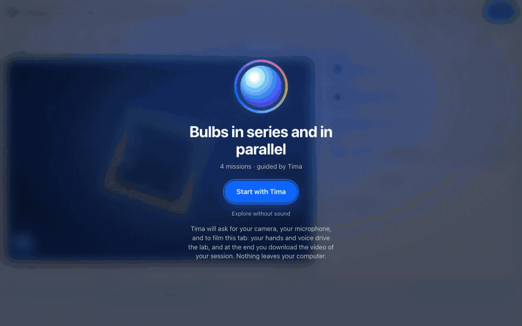
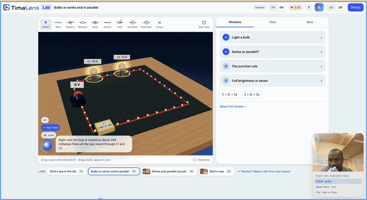

<p align="center"></p>

<h1 align="center">TimaLens Lab</h1>

<p align="center"><b>Chaque élève mérite un laboratoire de physique. La plupart n'en verront jamais.</b><br>
Un cours entre. Un laboratoire de circuits électriques, vivant et guidé à la voix, en sort, sur n'importe quel appareil, en une minute.</p>

<p align="center">
  <a href="https://lab.timalens.com"><b>Essayer en ligne : lab.timalens.com</b></a> ·
  <a href="https://lab.timalens.com/teach">Pour les enseignants</a> ·
  <a href="README.md">English</a>
</p>

<p align="center"></p>

TimaLens Lab est un module développé par **TimaLens Ltd**. Il transforme le cours d'un enseignant
en un laboratoire interactif que les élèves ouvrent n'importe où, pratiquent à leur rythme, et
pilotent avec leurs mains et leur voix, guidés par **Tima**, une tutrice vocale construite sur les
modèles Muse de Meta.

---

## Le problème

Dans une grande partie du monde, et dans la plupart des pays d'Afrique, **un laboratoire de
physique est un privilège**. Beaucoup de lycées n'en ont pas. Les universités qui en ont un
partagent quelques paillasses entre des centaines d'étudiants, les ouvrent pour une poignée de
séances encadrées par semestre, et les ferment le reste du temps.

Alors les élèves découvrent l'électricité au tableau. Ils recopient un schéma, apprennent
`U = R × I` par cœur, et passent un examen sur des circuits qu'ils n'ont jamais montés. Ceux qui
accèdent enfin à une vraie paillasse ont quelques minutes, pas des heures, et pas le droit à
l'erreur : le matériel est rare, et **un mauvais branchement grille un composant qui ne sera peut-être
pas remplacé cette année**. Chaque multimètre cassé, chaque DEL grillée, chaque lampe branchée en
court-circuit appauvrit le labo pour la classe suivante.

Ce qui manque aux élèves, ce n'est pas l'intelligence. C'est **la pratique** : la liberté
d'essayer, de se tromper, de comprendre pourquoi, et de recommencer, en dehors des heures de cours,
à leur rythme, sans autorisation et sans rien casser.

## Ce que fait TimaLens Lab

**L'enseignant téléverse un cours** (PDF, Word, PowerPoint, photo du tableau, enregistrement de la
classe). Muse Spark le lit et conçoit un labo autour : circuits, expériences guidées, défis, quiz.
Un moteur physique prouve que chaque défi est faisable. Un lien part à la classe, par WhatsApp s'il
le faut.

**L'élève ouvre le lien** et se retrouve dans un labo : une paillasse 3D réaliste, ou un schéma 2D,
où les circuits se comportent comme dans la vie. Les lampes brillent avec le bon éclat. Les DEL
grillent, avec des étincelles, quand le courant est trop fort, et se réparent d'un geste. Les erreurs
ne coûtent rien, et apprennent tout.

<p align="center"><br>
<sub>Une vraie séance sur lab.timalens.com : la paillasse tourne avec la main de l'élève, Tima explique, et le labo filme tout.</sub></p>

## Les fonctionnalités

- **Tout cours, tout format**, lu par Muse Spark (vision pour les photos) et Muse Voice Transcribe (enregistrements).
- **Un labo en une minute, raconté en direct** : Tima lit à voix haute le raisonnement de Muse Spark pendant qu'il conçoit, répond aux questions de l'enseignant, et ouvre le labo quand il est prêt.
- **Une couverture pour chaque labo**, dessinée par Muse Image.
- **Une visite guidée parlée** à la première visite, et des **missions** qui avancent seules quand le circuit atteint l'objectif.
- **Construction par glisser-déposer** en 2D et en 3D, paillasse immersive, **WebXR sur Meta Quest**.
- **Les mains, par la webcam**, actives par défaut : viser, rester sur un bouton pour cliquer, pincer pour attraper, ouvrir la main pour tourner, fermer le poing pour parler à Tima. Le suivi tourne dans le navigateur.
- **La voix, partout** : « Hey Tima », réponses sans répéter son nom, interruption naturelle.
- **Toute la séance filmée**, avec l'accord de l'élève : l'écran, son visage et les voix, en MP4 à télécharger à la fin.
- **Pensé pour le terrain** : application statique mise en cache, 3D et vidéo chargées à la demande, tuteur de secours hors ligne. Contenu en wolof, haoussa, yorùbá, fɔngbè, kiswahili, bamanankan.

## L'ingénierie autour de Muse Spark

La règle fondatrice : **le modèle configure le labo, il ne calcule jamais la physique.** Chaque
tension, intensité et éclat vient d'un moteur déterministe (analyse nodale modifiée, modèle de DEL,
lampes avec éclat et claquage), le même fichier dans le navigateur, le vérificateur du serveur, la
paillasse 3D et la vidéo.

- **Un schéma fermé** : la sortie structurée suit exactement le schéma, chaque objet nomme ses clés et interdit les autres.
- **Générer, vérifier, réparer** : le moteur résout chaque circuit et prouve que chaque défi est faisable sans être déjà réussi ; les problèmes repartent vers Muse Spark en mots simples.
- **Le raisonnement rendu audible** : les résumés de raisonnement de l'API Responses sont lus par Tima à l'enseignant.
- **Une tutrice ancrée et qui voit** : le cours, le circuit résolu, et une image du banc de l'élève pour la vision de Muse Spark.
- **Des oreilles en temps réel** : le micro passe par le serveur vers Muse Voice Transcribe ; la clé ne quitte jamais le serveur.

## Démarrer

```bash
cp .env.example .env        # MODEL_API_KEY (Meta), MISTRAL_API_KEY (optionnel)
make install && make dev    # l'app sur http://localhost:3000
```

Déploiement : `make deploy PROJECT=… DOMAIN=…` (voir [infra/README.md](infra/README.md)).
Tests : `make test` et `make e2e`.

© 2026 TimaLens Ltd · [Licence MIT](LICENSE)
