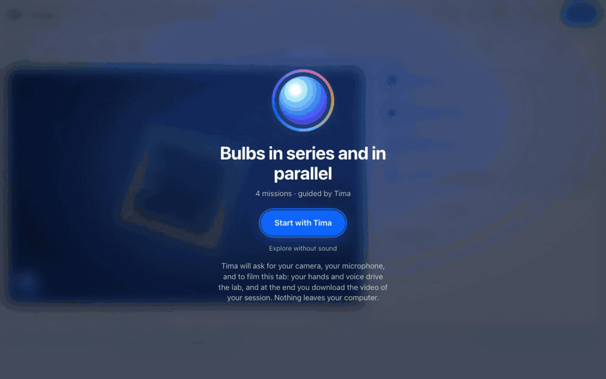
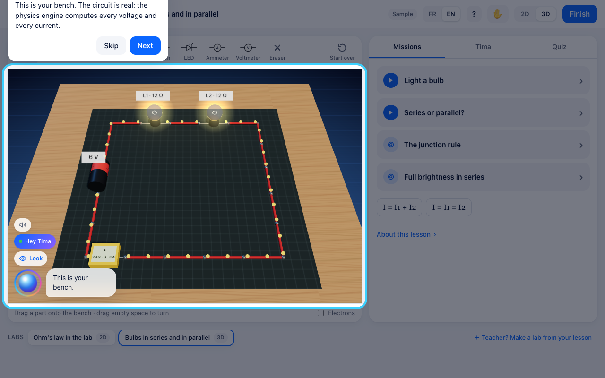
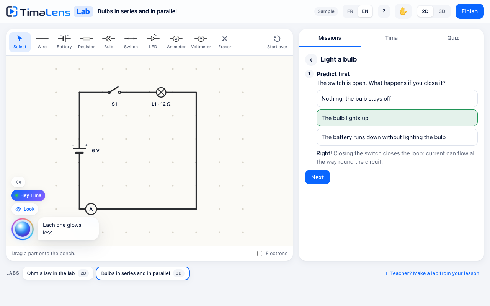
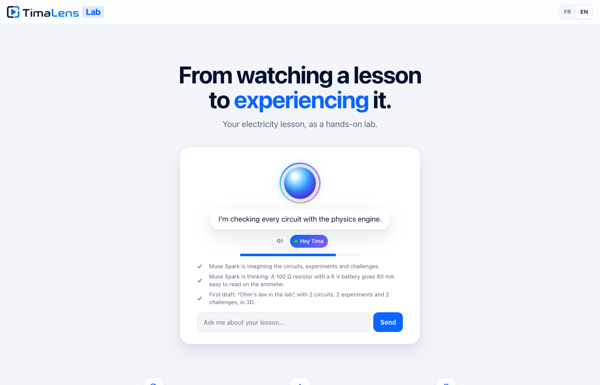
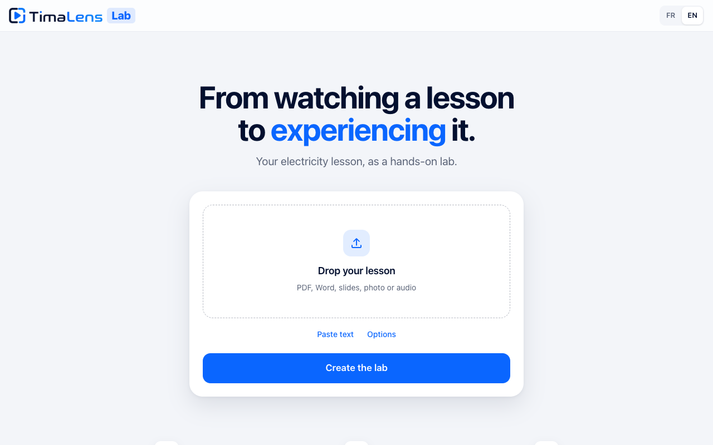

<p align="center"></p>

<h1 align="center">TimaLens Lab</h1>

<p align="center"><b>Every student deserves a physics lab. Most never get one.</b><br>
A lesson goes in. A living, voice-guided electric-circuits lab comes out, on any device, in a minute.</p>

<p align="center">
  <a href="https://lab.timalens.com"><b>Try it live: lab.timalens.com</b></a> ·
  <a href="https://lab.timalens.com/teach">For teachers</a> ·
  <a href="SUBMISSION.md">Hackathon submission</a> ·
  <a href="README.fr.md">Français</a>
</p>

<p align="center">
  <a href="https://github.com/ialim0/timalens-lab/actions/workflows/ci.yml"></a>
  
  
  <a href="LICENSE"></a>
</p>

<p align="center"></p>

TimaLens Lab is a module developed by **TimaLens Ltd**. It turns a teacher's own lesson into an
interactive laboratory that students can open anywhere, practise in at their own pace, and drive
with their hands and voice, guided by **Tima**, a voice tutor built on Meta's Muse models.

---

## The problem

In much of the world, and across most of Africa, **a physics lab is a privilege**. Many secondary
schools have none. Universities that do have one share a few benches between hundreds of students,
open them for a handful of supervised sessions a semester, and lock them the rest of the time.

So students meet electricity on a blackboard. They copy a diagram, memorise `U = R × I`, and sit an
exam about circuits they have never built. The few who reach a real bench have minutes, not hours,
and no right to fail: the equipment is scarce, and **a wrong connection burns a component that may
not be replaced this year**. Every broken multimeter, every blown LED, every bulb wired straight
across a battery makes the lab poorer for the next class.

What students lack is not intelligence. It is **practice**: the freedom to try, get it wrong, see
why, and try again, outside class hours, at their own pace, without anyone's permission and
without breaking anything.

Generic simulators help, but they teach someone else's lesson, in someone else's words and
notation. A teacher in Cotonou, Dakar or Kumasi has no way to turn *their* chapter into *their*
students' lab.

## What TimaLens Lab does

**A teacher uploads a lesson** (a PDF, a Word or PowerPoint file, a photo of the blackboard, a
recording of the class). Muse Spark reads it and designs a lab around it: the circuits, the guided
experiments, the challenges, the quiz. A physics engine proves every challenge can be met. One link
goes to the class, on WhatsApp if need be.

**A student opens the link** and is in a lab: a real-feeling 3D bench, or a 2D schematic, where
circuits behave as they do in life. Bulbs glow with the right brightness. LEDs burn out, with
sparks, when the current is too high, and are repaired with a tap. Mistakes cost nothing, and
teach everything.

| A guided tour on first visit | Tima answers, and points at what she means |
|---|---|
|  |  |
| **While the lab is made, Tima reads Muse Spark's reasoning aloud** | **The teacher's page: one action** |
|  |  |

## Features

**For the teacher**
- **Any lesson, any format:** PDF, DOCX, PPTX, text, a photo of the board or a notebook (Muse Spark vision), a recording of the class (Muse Voice Transcribe).
- **A lab in about a minute, narrated live.** Tima tells the teacher what is really happening: the lesson she read, Muse Spark's reasoning as it designs, the problems the engine finds and fixes. The teacher can talk to her meanwhile; when the lab is ready, it opens by itself.
- **Faithful to the lesson:** its notation (U or V), its level, its worked examples, the mistakes it warns about.
- **A cover for every lab**, drawn by Muse Image.
- **Local languages:** the lab's content in Wolof, Hausa, Yorùbá, Fɔngbè, Kiswahili or Bamanankan; the interface in French and English. A translation can change only the words: the engine re-checks that the physics did not move.

**For the student**
- **A lab as the front door**, with a spoken guided tour on first visit, and the other labs one tap away.
- **Missions:** guided experiments (*predict → do → observe*), challenges the engine checks live, a quiz. Steps move on by themselves when the circuit meets their goal; measurements record themselves and draw `U(I)` as the student turns a dial.
- **Drag-and-drop building** in 2D and 3D, with a glowing preview of where a part will land.
- **An immersive 3D bench:** a floating table over a glowing floor, a camera fly-in, real resistor colour bands, glowing bulbs, smoke and sparks when a part burns, **WebXR on Meta Quest**.
- **Hands, through the webcam**, on by default: point to aim (hold still on a button to click it), pinch to grab a part, open the hand to turn the bench, make a fist to talk to Tima. Tracking runs in the browser.
- **Voice, everywhere:** say *"Hey Tima"*, ask, and reply without her name; talk over her and she listens.
- **The whole session, filmed:** with the student's consent the lab records itself (the screen, the student's face, both voices) and hands over an MP4 at the end, ready for WhatsApp.
- **Built for real conditions:** a static web app cached for good after the first visit, 3D and video code loaded only when used, and a tutor that falls back on the engine's own readings when the network drops.

## How Muse Spark is engineered in

The founding rule: **the model configures the lab; it never computes the physics.** Every voltage,
current and brightness a student sees comes from a deterministic engine. Muse Spark is used where
it is irreplaceable (reading a lesson, designing pedagogy, explaining, conversing) and is boxed in
everywhere else.

```
 lesson ─▶ Muse Spark vision / Muse Voice Transcribe ─▶ text
        ─▶ Muse Spark on the Responses API
             · structured output against a closed JSON Schema          (text.format)
             · reasoning summaries streamed ─▶ Tima reads them aloud    (reasoning.summary)
        ─▶ circuit engine: lays out, solves, and searches the student's controls
             to PROVE each challenge is achievable and not already met
             └─ problems go back to Muse Spark in plain words (up to 3 rounds)
        ─▶ lab JSON ─▶ the same engine, in the student's browser
```

- **A closed schema.** Decoding is constrained to the schema, so the schema *is* the contract: every object names its keys, forbids all others (`additionalProperties: false`), and lists the values it accepts. The first real run taught us why: with an open schema, the model invented keys until it hit the output limit, 555,386 characters of them. A test now checks the schema against every field of the hand-written labs.
- **Generate, check, repair.** The engine is the referee. It solves every preset, then explores the controls a student may touch to prove each challenge can be won, and that none is already won at the start. What fails goes back to Muse Spark as plain sentences.
- **Reasoning, made audible.** On the Responses API, Muse Spark streams summaries of its reasoning; each one becomes an event that Tima speaks to the teacher, in the teacher's language.
- **Room to think, and recovery when it runs out.** Reasoning tokens count against the output budget, so the request leaves room for both; an answer cut short (`response.incomplete`) is designed again at lower effort instead of handing the engine half a lab.
- **A grounded, seeing tutor.** Tima's answers come from the teacher's lesson plus the solved circuit (every value, every reading), plus **a picture of the student's bench** for Muse Spark's vision. She is Socratic: she never hands over a challenge's answer. Answers stream, and each finished sentence is spoken at once.
- **Realtime ears, safely relayed.** The microphone streams through the server to Muse Voice Transcribe realtime (the key never reaches the browser), with endpointing and "Tima" as a recognition keyword.
- **Fail fast, say why.** If Meta's API cannot be reached, calls give up in seconds and the teacher is told plainly, before uploading.

| Meta model | Role in TimaLens Lab |
|---|---|
| **Muse Spark 1.3** (or **Muse Wonder** via `DESIGN_MODEL`) | Designs the lab: Responses API, closed structured output, streamed reasoning summaries, repair loop |
| **Muse Spark vision** | Reads photographed lessons; sees the student's bench when they ask Tima |
| **Muse Spark** (Contributor mode via `TUTOR_MODEL`) | Tima the tutor: grounded in the lesson and the live circuit, streamed |
| **Muse Voice Transcribe (realtime)** | Tima's ears: streaming transcription, endpointing, keyword biasing, FR/EN code-switching |
| **Muse Voice Transcribe** | Recorded lessons to text |
| **Muse Image** | Each lab's cover, drawn while the engine checks it |
| **Muse Spark Open** (optional) | `PLANNER_BASE_URL` runs the designer and the tutor on open weights, on a school's own GPUs or a hosted partner |

Tima's spoken voice is Voxtral (Mistral), because Muse Voice Transcribe is speech-to-text only;
without a key, the browser's voice speaks.

## The engine

`frontend/src/lab/circuit.js` is a deterministic DC solver, tested against hand-worked answers:
modified nodal analysis, batteries with internal resistance, a piecewise LED model with iteration,
bulbs with brightness and burnout, short-circuit detection. **The same file** runs in the student's
browser, in the server's checker, on the 3D bench and in the video renderer: what the checker
proved is exactly what the student gets.

## Architecture

```
frontend/          Next.js (React + TypeScript), exported as static files
  src/app/         /  (opens a lab) · /lab · /teach · /replay
  src/components/  the teacher's page, the lab's layout, the replay
  src/lab/         circuit.js engine · labcheck.js checker · board.js 2D · bench3d.js 3D + WebXR
                   tima.js + voice.js Tima · hands.js hand tracking · recorder.js session film
                   tour.js guided tour · session.js event log · video.js log → MP4
  e2e/             Playwright: the whole app in Chrome
app/               FastAPI: lesson reading, the design loop, the tutor, Tima's realtime relay and voice
infra/terraform/   Google Cloud Run, Secret Manager, a GCS volume, a custom domain
samples/           hand-written labs (FR/EN) and a lesson PDF
tests/             engine (Node) and server (pytest) suites
```

One container serves everything: the API, the WebSocket for Tima's ears, and the web app.

## Quick start

```bash
git clone https://github.com/ialim0/timalens-lab && cd timalens-lab
cp .env.example .env        # MODEL_API_KEY (Meta), MISTRAL_API_KEY (optional, Tima's voice)
make install                # Python virtualenv + npm
make dev                    # API on :8080, web app on http://localhost:3000
```

Or `docker compose up --build`, then http://localhost:8080. The sample labs work without any key.

## Deploy

```bash
export TF_VAR_model_api_key=... TF_VAR_mistral_api_key=...
make deploy PROJECT=my-gcp-project REGION=us-central1 DOMAIN=lab.example.com
```

Cloud Build makes the image, Terraform creates Cloud Run, Secret Manager entries for the keys, a
versioned bucket for the labs, a least-privilege service account and the domain mapping. See
[infra/README.md](infra/README.md).

## Configuration

| Variable | Purpose | Default |
|---|---|---|
| `MODEL_API_KEY` | Meta Model API key | — |
| `MISTRAL_API_KEY` | Tima's voice (Voxtral); without it the browser speaks | — |
| `PLANNER_MODEL` · `DESIGN_MODEL` · `TUTOR_MODEL` | Models for each job | `muse-spark-1.3` |
| `PLANNER_EFFORT` | Reasoning effort for the design | `medium` |
| `IMAGE_MODEL` · `ASR_MODEL` | Cover drawing, transcription | `muse-image-1.0` · `muse-voice-transcribe-1.0` |
| `PLANNER_BASE_URL` · `PLANNER_API_KEY` | An open-weight server instead (optional) | — |
| `DATA_DIR` | Where labs and sessions are stored | `./data` |

## Quality

```bash
make test    # 25 engine tests (Node) + 43 server tests (pytest)
make e2e     # 27 end-to-end tests in Chrome (Playwright)
make lint    # ruff + TypeScript + terraform fmt
```

No test calls a model or needs a key: the server tests stand in for Muse Spark, Muse Image and
Meta's realtime ears with fakes shaped like the API's documented events; the end-to-end tests stand
in for the microphone, the camera, the tab share and the tutor, and drive MediaPipe for real. CI
runs all of it, then builds and smoke-tests the Docker image and validates the Terraform.

## Privacy and safety

- API keys live on the server (Secret Manager in production); the browser never sees them.
- Hand tracking runs in the browser; the webcam video never leaves the computer.
- A session is filmed only after the student shares the tab, and the film stays in the browser until they download it.
- See [SECURITY.md](SECURITY.md) to report a vulnerability.

## Contributing and license

Contributions are welcome: read [CONTRIBUTING.md](CONTRIBUTING.md) and the
[Code of Conduct](CODE_OF_CONDUCT.md). © 2026 TimaLens Ltd, released under the [MIT License](LICENSE).
